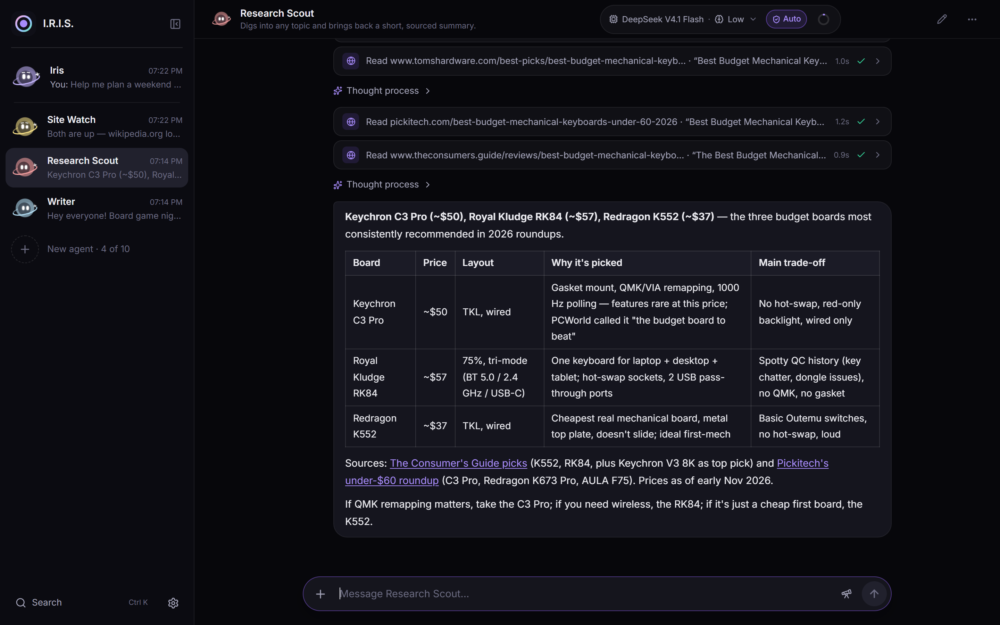
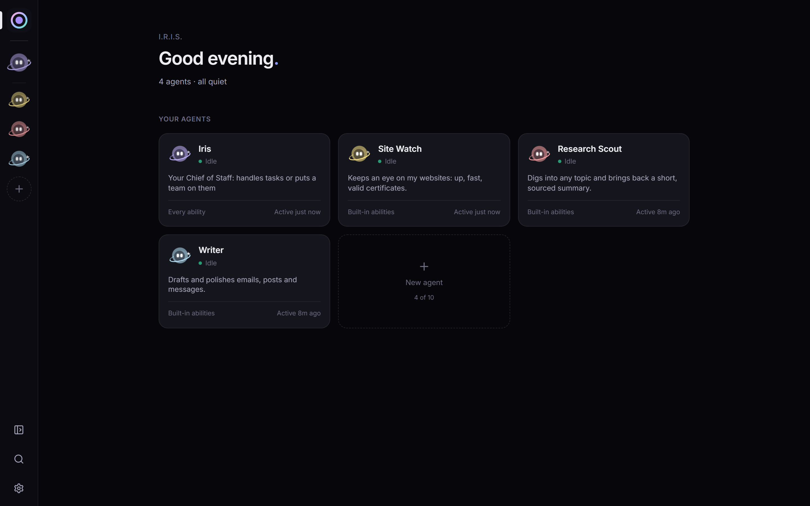
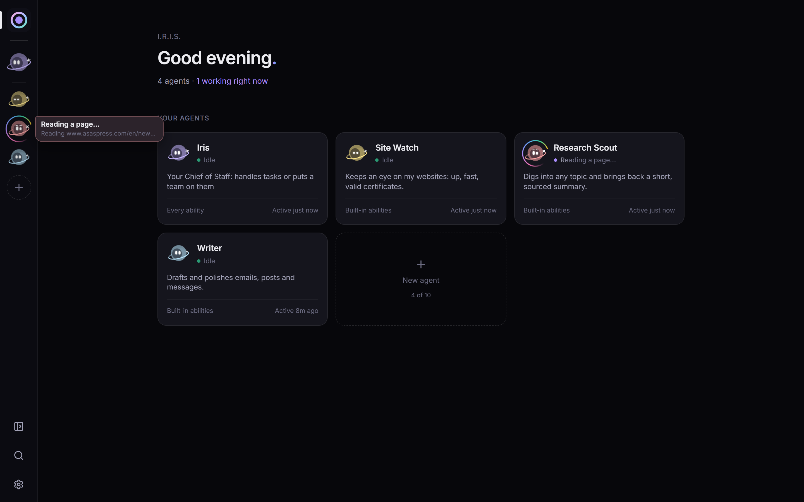
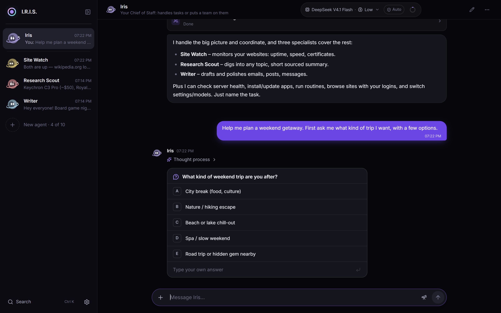
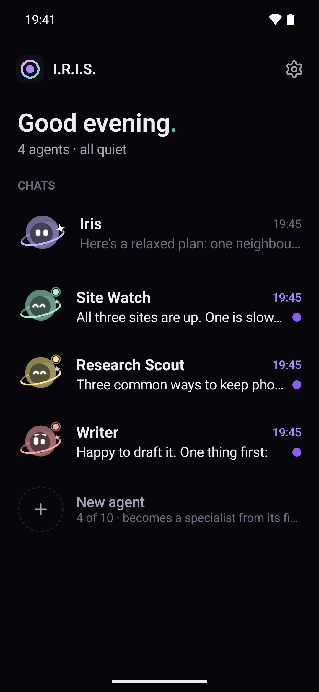
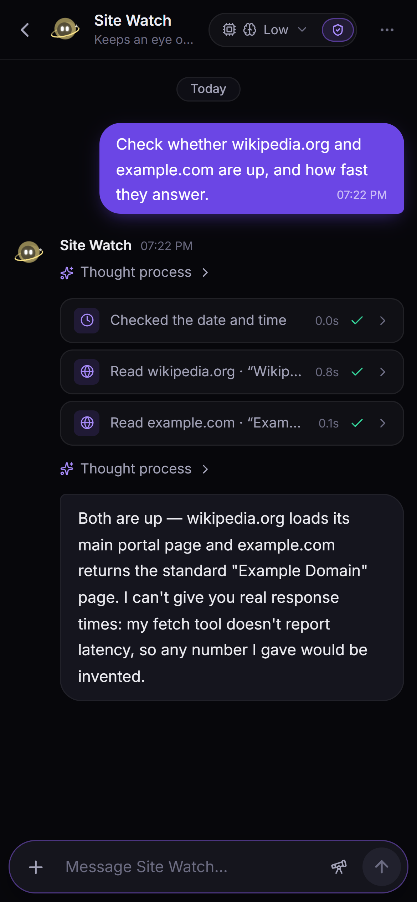
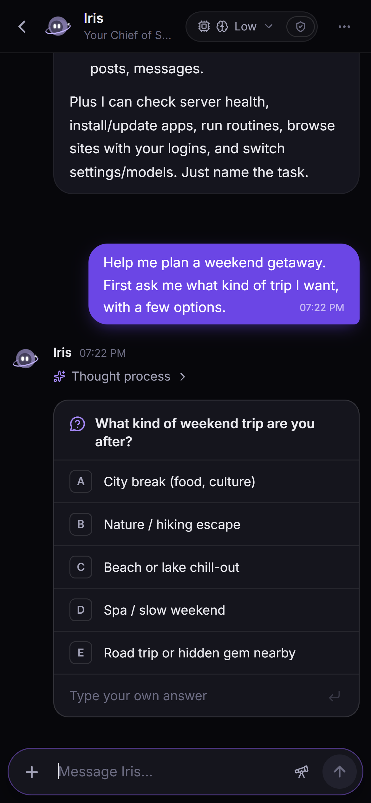

<div align="center">

# I.R.I.S.

**I**ntelligent **R**easoning & **I**nitiative **S**ystem

**Your own team of AI agents, running on your own PC.**<br>
Chat with them from your desktop, any browser, or your Android phone.

<a href="https://github.com/Joji228/IRIS-Intelligent-Reasoning-Initiative-System/releases/download/v0.2.3/IRIS-Setup-x64-v0.2.3.exe"></a>
&nbsp;
<a href="https://github.com/Joji228/IRIS-Intelligent-Reasoning-Initiative-System/releases/download/v0.2.3/IRIS-Android-v0.2.3.apk"></a>

<sub>Windows 10/11 (64-bit) · Android 10+ · Free and open source ([MIT](LICENSE))</sub>



</div>

## What it is

- **A team, not one bot.** **Iris**, your Chief of Staff, answers simple things herself and hands bigger jobs to specialists. Make your own with one sentence ("an agent that checks my websites every morning").
- **Agents that actually do things.** They search and read the web, drive a real browser, work with files, run commands, keep your PC updated, and follow schedules: up to 10 agents, each with its own memory.
- **You stay in charge.** Risky steps wait for your OK. Agents ask you questions as clickable cards. Anything that failed lands in one inbox with a Retry button.
- **Private by design.** Everything runs and stays on your machine. Remote access through the relay (a small service you deploy yourself) is end-to-end encrypted.
- **Any model.** DeepSeek by default, or any OpenAI-compatible provider (OpenAI, Groq, OpenRouter, a local server…).
- **Keeps itself up to date.** One button installs a new version on the PC, and the phone app updates the same way.

## See it

| | |
|---|---|
|  |  |
| **Home.** Every agent at a glance. | **At work.** Each orb shows what it's doing, live. |
|  |  |
| **Questions.** Answer with one tap. | **Research.** Every step visible, sources included. |

**On your phone.** The Android app: every chat with its agent's live orb, full replies (tables included), and questions you answer with one tap. Send photos and files, approve steps, and get notified when an agent needs you.

<p align="center">
  
  &nbsp;
  
  &nbsp;
  
</p>
<p align="center"><sub>Screenshots of the real apps with made-up agents and chats.</sub></p>

## Install (5 minutes)

1. **Download** [**IRIS-Setup-x64-v0.2.3.exe**](https://github.com/Joji228/IRIS-Intelligent-Reasoning-Initiative-System/releases/download/v0.2.3/IRIS-Setup-x64-v0.2.3.exe) and run it.<br>
   <sub>Windows may warn because the installer isn't signed yet: **More info → Run anyway**.</sub>
2. **Add a model.** Open **Settings → Providers** and paste an API key, for example from [DeepSeek](https://platform.deepseek.com/) (cheap and capable).
3. **Say hi to Iris.** Ask her anything, or press **+** and describe the agent you want.

That's it. I.R.I.S. starts with Windows and lives in the tray, so your agents keep working while the window is closed.

## Use it from your phone (optional, ~10 minutes)

The phone app always connects through a relay, which keeps everything end-to-end encrypted, at home and away. You deploy your own free relay on Cloudflare once (a browser at home can also open `http://<your PC>:7700` directly, unencrypted):

1. Install [Node.js](https://nodejs.org/). In this repo's `relay` folder, run `npm install` and then `npx wrangler login` (it opens a browser to sign in to a free Cloudflare account).
2. Make a server key and save it where I.R.I.S. looks for it (PowerShell):
   ```powershell
   New-Item -ItemType Directory -Force "$env:LOCALAPPDATA\dev.iris.desktop\secrets" | Out-Null
   $b = New-Object byte[] 32; [Security.Cryptography.RandomNumberGenerator]::Create().GetBytes($b)
   ($b | ForEach-Object { $_.ToString('x2') }) -join '' | Set-Content "$env:LOCALAPPDATA\dev.iris.desktop\secrets\relay.key" -NoNewline
   Get-Content "$env:LOCALAPPDATA\dev.iris.desktop\secrets\relay.key"
   ```
3. Give the relay the same key, and deploy it:
   ```bash
   npx wrangler secret put SERVER_KEY      # paste the key from step 2
   npm run deploy                          # prints https://iris.<your-name>.workers.dev
   ```
4. In I.R.I.S., open **Settings → Remote access**, paste that address, and turn it on.
5. **Pair a device:**
   - **Android:** install [**IRIS-Android-v0.2.3.apk**](https://github.com/Joji228/IRIS-Intelligent-Reasoning-Initiative-System/releases/download/v0.2.3/IRIS-Android-v0.2.3.apk) (allow installs from your browser when asked) and scan the QR code shown in Settings. Allow notifications, and set battery use to *Unrestricted* so they arrive.
     <br><sub>Coming from 0.1.0? Uninstall that one first: 0.2.0 is signed with a permanent key and Android won't update over an app signed with a different one. You pair the phone again; nothing on your PC is affected.</sub>
   - **Any browser:** open your relay address and scan the same QR code, or type the pairing code.

## Updating

I.R.I.S. checks this repository's releases every few hours. When a newer version is out, a bar at the top says so, with an **Update now** button: it downloads the installer, checks it against the checksum GitHub lists for the file, closes the app, installs, and opens it again. Your chats, agents and settings stay. The phone app shows the same news on its home screen and in Settings → About; it downloads the new APK, checks it, and Android asks you to confirm the install.

The check only asks GitHub for the latest release (GitHub sees your IP address, like for any web request). To turn it off, clear the box in Settings → About, or set `check = false` under `[update]` in `iris.toml`.

## Safe by default

- **Approvals:** commands, installs, restarts, payments and lasting changes ask first. Per agent, you can let some run on their own (*Careful* or *Full* auto).
- **Encryption:** every message sent through the relay (I.R.I.S. Link) is encrypted end to end (ECDH P-256 + AES-256-GCM), and the relay only sees sealed data. Connecting directly over your home network (`http://<your PC>:7700`) is **not** encrypted: use it only on a network you trust, and use the relay for anything else.
- **Keys and logins:** they stay on your PC and are never shown to agents. Saved logins are encrypted with Windows DPAPI.
- **Web content:** it's treated as untrusted. Replies are sanitized and remote images never load. Agents are told that web pages, emails and other outside text are information, not orders, and what comes back from them is labelled. After reading the web or a connected service, agents need your OK for lasting changes, Full auto goes back to reviewing commands, and a web address or form that would carry your own text out asks first. This reduces prompt-injection risk; it can't remove it (see [SECURITY.md](SECURITY.md)).

Found a security problem? Please report it privately: see [SECURITY.md](SECURITY.md).

## Build it yourself

On Windows with Git, Node.js, Rust and the VS C++ Build Tools (`scripts\server-setup.ps1` installs them):

```powershell
scripts\build-windows.ps1                       # → target\release\bundle\nsis\IRIS_<version>_x64-setup.exe
cd android; .\gradlew assembleRelease           # → android\app\build\outputs\apk\release\app-release.apk
```

How it all works (engine, API, tools, team, relay, Android app): [docs/DEV.md](docs/DEV.md).

## License

[MIT](LICENSE). Early software: it works and is used every day, but expect rough edges.
